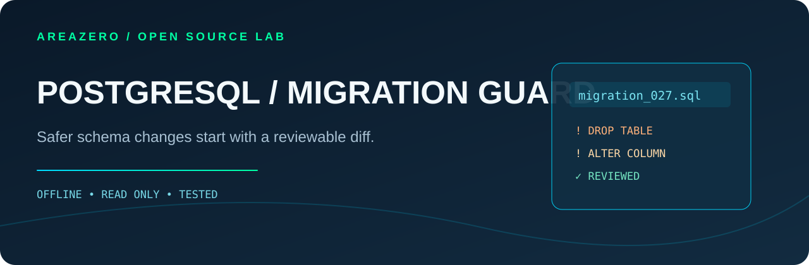

<p align="center"></p>
<p align="center"></p>

# PG Migration Risk Audit

**Spot risky migrations before the release window — with line-level evidence, not database access.** A portable, deterministic Agent Skill for Claude Code, Codex and maintainers reviewing PostgreSQL migration pull requests. Focuses on production-impacting DDL and data-change patterns rather than generic SQL formatting.

[](https://github.com/Kanompung1988/pg-migration-risk-audit/actions/workflows/ci.yml) · [Agent Skills spec](https://agentskills.io/specification) · [Rule reference](references/RULES.md) · [MIT source license](LICENSE)

## Why this exists
Production deploys can fail on lock contention and irreversible destructive changes. PostgreSQL documents that `ALTER TABLE` often takes `ACCESS EXCLUSIVE` locks, while a regular `CREATE INDEX` can block writers. `CREATE INDEX CONCURRENTLY` reduces write blocking but must not run within an explicit transaction block. These distinctions matter during a coding-agent-assisted PR review, not just to a DBA at launch time.

## Quickstart

```bash
git clone https://github.com/Kanompung1988/pg-migration-risk-audit.git
cd pg-migration-risk-audit
python scripts/audit.py examples/unsafe.sql --format markdown --fail-on none
python scripts/audit.py /path/to/project/migrations --format json --fail-on high
# 0 = below threshold, 2 = review findings, 1 = read/parse input error
```

### Install in agent workspace

```bash
# Claude Code (project-local)
mkdir -p .claude/skills
git clone --depth 1 https://github.com/Kanompung1988/pg-migration-risk-audit.git .claude/skills/pg-migration-risk-audit
# Codex (project-local)
mkdir -p .agents/skills
git clone --depth 1 https://github.com/Kanompung1988/pg-migration-risk-audit.git .agents/skills/pg-migration-risk-audit
```

Prompt your agent: *"Review these PostgreSQL migration SQL files for lock and data-loss risks, summarize line-based findings and a safe rollout checklist. Do not run SQL."*

## What the output looks like

```text
CRITICAL PG001 unsafe.sql:2 — DROP TABLE/SCHEMA may irreversibly remove data.
HIGH     PG002 unsafe.sql:3 — ALTER TABLE DROP COLUMN/CONSTRAINT changes existing schema.
HIGH     PG004 unsafe.sql:4 — UPDATE statement has no WHERE clause.
HIGH     PG006 unsafe.sql:7 — CREATE INDEX CONCURRENTLY is inside an explicit transaction block.
MEDIUM   PG005 unsafe.sql:9 — CREATE INDEX without CONCURRENTLY can block writers.
```

Illustrative subset of the included synthetic fixture, not a claim about a live database. Use `--format json` for structured automation and `--fail-on critical|high|medium|low|none` for CI gates.

## Architecture and verifiable QA
- `scripts/audit.py`: PostgreSQL-style masking for strings, nested comments and dollar-quoted blocks; statement-aware rule checks and deterministic reports.
- `tests/test_audit.py`: standard-library unittest regression suite, CLI exit codes, file caps and symlink safety.
- `examples/unsafe.sql`, `examples/safe.sql`: synthetic migration fixtures, never executed.
- `.github/workflows/ci.yml`: independent test+fixture smoke job on Python 3.10 and 3.12.

```bash
python -m unittest discover -s tests -v
python scripts/audit.py examples/unsafe.sql --format json --fail-on none > /tmp/pg-audit.json
```

## Trust boundary, limitations and attribution
This is not a SQL AST parser or a substitute for `EXPLAIN`, lock observation, migration rehearsals, backups, rollback and human DBA approval. The `WHERE` heuristic only covers direct statement-leading UPDATE/DELETE; procedural code and complex SQL require a real parser or manual review. It reads SQL as untrusted data and does not execute it or send it to a service. Refer to [rules](references/RULES.md) and [PostgreSQL primary docs](references/SOURCES.md). Original code and docs © 2026 AREAZERO Skill Lab under MIT; the unmodified official Area Zero logo belongs to its owner and is **not** covered by the code's MIT license. No independent security certification is implied.
